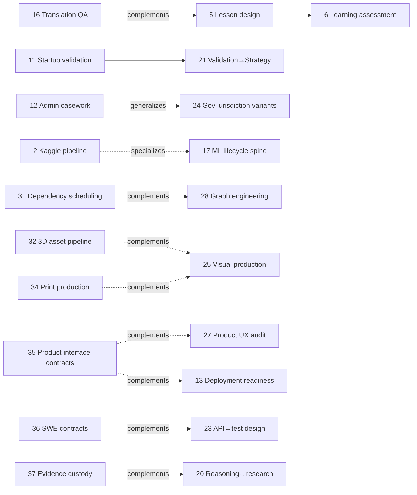

# Skill Factory

[](https://github.com/BhasPROcoder/skill-factory/actions/workflows/validate.yml)
[](LICENSE)


A local library of portable, task-focused instructions. Each skill contains inputs, an explicit procedure, decision rules, an output template, a fictional worked example, failure cases, and a test request.

## Use a skill

1. Open [ROUTER.md](ROUTER.md) and choose a domain.
2. Follow its domain index and select the task whose description matches your request.
3. Give your model the selected `SKILL.md` and your real inputs. Load one skill at a time rather than the whole library.
4. Check the resulting artifact against the skill's quality checklist and test assertions.

The instructions are plain Markdown and do not require a particular model or plugin. They do not grant permission to send messages, submit applications, change production systems, or publish content.

## Find useful areas

- Datasets, data quality, analytical workflows, model evaluation, and reproducibility.
- Kaggle competition preparation and hackathon delivery workflows.
- SEO: search content, site architecture, local search, campaign planning, email, sales, and ecommerce.
- India and US administrative services, government casework, public policy, education, and research.
- Contracts, compliance preparation, business planning, creative work, media, and communication.

The router shows actual domain coverage. A topic's presence does not imply that every specialization, jurisdiction, or platform feature is covered.

For upcoming work, see the [5,000-skill expansion plan](plans/5000-additional-skills.md) and [directory topic map](plans/directory-integration.md). The map includes proposed topics; use the router to find skills available now.

## Where things live

Three separate collections exist in and around this repo — don't assume they're one thing:

- **`skills/<DOMAIN-CODE>/<name>/SKILL.md`** — the registry-driven, SPEC.md-governed library this README mostly describes. Every entry here has a row in `registry/skills.jsonl`, passed `sf.py check-registry`/`validate`, and matches the exact 11-section format in `SPEC.md`.
- **`local-skills/`** — a raw, un-registered staging area (`gsd/`, `academic-research-skills/`, `custom/`, `marketplace/`) mirroring the repo owner's personal `~/.claude/skills` folder. Nothing in here has a registry entry or SPEC.md-compliant frontmatter; it's reference material, not part of the validated library.
- **The owner's personal `~/.claude/skills`** (outside this repo) — where externally-sourced skills get installed directly when they're a better fit for a personal workflow than for this portable factory (see `logs/x-posts-harvest.md` for a recent batch: `emil-design-eng`, `android-reverse-engineering`, `baoyu-electron-extract`, `mattpocock-code-review`).

## Skill relationship graph

[`logs/skill-graph-chunks.md`](logs/skill-graph-chunks.md) documents a typed relationship graph
over `skills/` — not just the flat domain list, but which skills actually feed into, complement,
or specialize each other, grouped into named multi-skill "chunks" (e.g. "Hackathon delivery
pipeline," "ML project lifecycle spine"). Graph data: [`registry/skill-graph-nodes.jsonl`](registry/skill-graph-nodes.jsonl)
and [`registry/skill-graph-edges.jsonl`](registry/skill-graph-edges.jsonl).

As of the last `python tools/sf.py status` run in this pass:

```text
macros: 37  domains: 81  skills: 645
planned: 0  written: 0  validated: 645  audited: 0  failed: 0
```

### Macro areas, by domain and skill count

Generated from `registry/skill-graph-nodes.jsonl` (the output of `python tools/sf.py graph-export`), not a hand count.

| Macro area | Domains | Skills |
|---|---:|---:|
| Sales & Marketing | 9 | 91 |
| AI/ML & Data Science | 8 | 75 |
| Software Engineering | 7 | 69 |
| Visual Arts, Photo & Video | 9 | 51 |
| Business & Strategy | 5 | 45 |
| Government & Public Policy | 4 | 40 |
| Operations & Supply Chain | 8 | 33 |
| Creative Writing | 3 | 30 |
| Research Methods & Academia | 4 | 26 |
| Product & Design | 5 | 22 |
| Education & Teaching | 2 | 21 |
| Law & Compliance | 3 | 15 |
| Prompt Engineering & LLM Ops | 2 | 14 |
| Music & Audio Production | 2 | 13 |
| DevOps & Cloud | 1 | 10 |
| Cybersecurity | 1 | 10 |
| E-commerce | 1 | 10 |
| Startups & Fundraising | 1 | 10 |
| Exam Prep | 1 | 10 |
| Career Development | 1 | 10 |
| Personal Productivity | 1 | 10 |
| Reasoning & Critical Thinking | 1 | 10 |
| Languages & Translation | 1 | 10 |
| Communication & Negotiation | 1 | 10 |
| **Total** | **81** | **645** |

13 macro areas in `registry/macros.json` have 0 domains so far (Finance/Accounting/Tax,
Mathematics, Physical Sciences, Life Sciences & Medicine, Psychology & Behavior, Writing &
Editing, Leadership & Management, HR & Hiring, Real Estate, History/Philosophy/Religion,
Health/Fitness/Nutrition, Games & Puzzles, Competitive Programming) — see
`python tools/sf.py macros` for the live TODO/DONE split.

### Chunks, by skill count

Mechanically counted from `logs/skill-graph-chunks.md`'s own section bodies (includes a skill
mentioned in a chunk's "Internal choices" cross-link note, not just its core membership list —
a few counts run slightly above the core-membership figure in the chunk's own text for that
reason). 309 of 645 skills are chunked; the rest are intentionally listed as "Unchunked" in that
file rather than forced into a relationship that doesn't exist.

| # | Chunk | Skills |
|---:|---|---:|
| 1 | [Hackathon delivery pipeline](logs/skill-graph-chunks.md#1-hackathon-delivery-pipeline) | 10 |
| 2 | [Kaggle competition pipeline](logs/skill-graph-chunks.md#2-kaggle-competition-pipeline) | 10 |
| 3 | [Exam preparation pipeline](logs/skill-graph-chunks.md#3-exam-preparation-pipeline) | 10 |
| 4 | [Career transition pipeline](logs/skill-graph-chunks.md#4-career-transition-pipeline) | 10 |
| 5 | [Lesson design pipeline](logs/skill-graph-chunks.md#5-lesson-design-pipeline) | 11 |
| 6 | [Learning assessment pipeline](logs/skill-graph-chunks.md#6-learning-assessment-pipeline) | 10 |
| 7 | [Personal weekly productivity system](logs/skill-graph-chunks.md#7-personal-weekly-productivity-system) | 10 |
| 8 | [Poem revision pipeline](logs/skill-graph-chunks.md#8-poem-revision-pipeline) | 10 |
| 9 | [Audio/music production pipeline](logs/skill-graph-chunks.md#9-audiomusic-production-pipeline) | 10 |
| 10 | [Startup service operations pipeline](logs/skill-graph-chunks.md#10-startup-service-operations-pipeline) | 10 |
| 11 | [Startup customer validation pipeline](logs/skill-graph-chunks.md#11-startup-customer-validation-pipeline) | 10 |
| 12 | [Administrative casework pipeline](logs/skill-graph-chunks.md#12-administrative-casework-pipeline) | 10 |
| 13 | [Deployment & incident readiness toolkit](logs/skill-graph-chunks.md#13-deployment--incident-readiness-toolkit) | 10 |
| 14 | [Defensive security review toolkit](logs/skill-graph-chunks.md#14-defensive-security-review-toolkit) | 10 |
| 15 | [E-commerce customer-journey audit toolkit](logs/skill-graph-chunks.md#15-e-commerce-customer-journey-audit-toolkit) | 10 |
| 16 | [Translation QA pipeline](logs/skill-graph-chunks.md#16-translation-qa-pipeline) | 11 |
| 17 | [ML project lifecycle spine](logs/skill-graph-chunks.md#17-ml-project-lifecycle-spine) | 14 |
| 18 | [Skill-design meta loop](logs/skill-graph-chunks.md#18-skill-design-meta-loop) | 4 |
| 19 | [Fiction: structure feeds scene craft](logs/skill-graph-chunks.md#19-fiction-structure-feeds-scene-craft) | 8 |
| 20 | [Reasoning feeds research synthesis](logs/skill-graph-chunks.md#20-reasoning-feeds-research-synthesis) | 8 |
| 21 | [Startup validation feeds strategy & fundraising](logs/skill-graph-chunks.md#21-startup-validation-feeds-strategy--fundraising) | 7 |
| 22 | [Commercial legal lifecycle](logs/skill-graph-chunks.md#22-commercial-legal-lifecycle) | 10 |
| 23 | [API contract feeds test design](logs/skill-graph-chunks.md#23-api-contract-feeds-test-design) | 4 |
| 24 | [Government citizen-services jurisdiction variants](logs/skill-graph-chunks.md#24-government-citizen-services-jurisdiction-variants) | 7 |
| 25 | [Visual production craft toolkit](logs/skill-graph-chunks.md#25-visual-production-craft-toolkit) | 4 |
| 26 | [Go-to-market content & campaign pipeline](logs/skill-graph-chunks.md#26-go-to-market-content--campaign-pipeline) | 12 |
| 27 | [Product UX audit & handoff pipeline](logs/skill-graph-chunks.md#27-product-ux-audit--handoff-pipeline) | 10 |
| 28 | [Graph engineering build pipeline](logs/skill-graph-chunks.md#28-graph-engineering-build-pipeline) | 17 |
| 29 | [Procurement-to-warehouse operations](logs/skill-graph-chunks.md#29-procurement-to-warehouse-operations) | 4 |
| 30 | [Service & rental fulfillment toolkit](logs/skill-graph-chunks.md#30-service--rental-fulfillment-toolkit) | 9 |
| 31 | [Dependency scheduling bridges to graph & planning](logs/skill-graph-chunks.md#31-dependency-scheduling-bridges-to-graph--planning) | 5 |
| 32 | [3D asset preparation & diagnostics pipeline](logs/skill-graph-chunks.md#32-3d-asset-preparation--diagnostics-pipeline) | 7 |
| 33 | [Museum & exhibition evidence toolkit](logs/skill-graph-chunks.md#33-museum--exhibition-evidence-toolkit) | 8 |
| 34 | [Print production handoff pipeline](logs/skill-graph-chunks.md#34-print-production-handoff-pipeline) | 7 |
| 35 | [Product interface contracts toolkit](logs/skill-graph-chunks.md#35-product-interface-contracts-toolkit) | 11 |
| 36 | [SWE machine/locale contract toolkit](logs/skill-graph-chunks.md#36-swe-machinelocale-contract-toolkit) | 6 |
| 37 | [Evidence chain-of-custody toolkit](logs/skill-graph-chunks.md#37-evidence-chain-of-custody-toolkit) | 6 |

### Chunk-to-chunk bridges

Most chunks are self-contained (one domain, or a few domains inside one macro area, with no
real dependency on another chunk). The real cross-chunk edges found this pass — 11 of them —
are what actually connects the graph:



The other 26 chunks (THK, GEX, GCA, GPR, GPO, TAM, MOP, TDV, TSC, MEC, Fiction, Legal, GTM, SKR
loop, Museum, Procurement, Service/Rental, and the rest) have no cross-chunk edge found this
pass — each is a complete pipeline or toolkit on its own. See
[`logs/skill-graph-chunks.md`](logs/skill-graph-chunks.md) for the full skill-by-skill detail,
including the 336-skill "Unchunked" list and the 23 domains flagged for a follow-up pass.

## Generalized workflows

The library also includes general-purpose workflows adapted from the user's former Claude skills collection. They use task inputs and verification steps instead of personal business details, vendor invocation commands, or assumed current prices and rules. The [migration comparison](logs/claude-migration.md) maps source workflows to new skills or existing equivalents so duplicate names do not inflate the repertoire.

All portable instructions live under `skills/` in this repository. Load the selected Markdown file and supply the required inputs in the AI agent you use; actual file editing, browsing, code execution, and connected services depend on that agent's available tools. The instructions do not claim every agent has identical capabilities.

## Accuracy and limits

Skills teach procedures and judgment. Current laws, agency requirements, fees, deadlines, platform rules, and delivery specifications are inputs to verify with their official source, not hardcoded current facts. Worked scenarios are fictional. Verification placeholders identify unresolved facts and where to check them.

`validated` means the repository's format checks passed. `quality` adds body-length, exact-duplicate, and registry-consistency checks. Neither proves factual accuracy or reliability across models. `audited` is reserved for a recorded substantive review, not automatically granted by a script. The library includes test cases; do not describe an unexecuted test as passed. See [logs/quality-review.md](logs/quality-review.md) for the actual review scope and limitations.

For law, finance, security, or other consequential decisions, use the task's professional and authorization boundaries. An organized brief or evidence table is not an authoritative legal determination or a production-system assessment.

## Inspect and validate

Run commands from this folder with an available Python 3 interpreter. The tools use the standard library.

```text
python tools/sf.py status
python tools/sf.py check-registry
python tools/sf.py validate --all
python tools/sf.py quality --all
python tools/sf.py coverage
python tools/sf.py overlap
python tools/sf.py search kaggle submission
python tools/sf.py search seo
python -m unittest discover -s tests -p test_sf.py
```

`overlap` produces lexical routing candidates for review; its output is not a semantic duplicate verdict.

## Export and test

```text
python tools/sf.py index --all
python tools/sf.py router
python tools/sf.py export dist/portable-skills
python tools/sf.py package dist/portable-skills.zip
python tools/sf.py testpack CTR-001
```

The export contains one folder per validated or audited skill, with minimal `name` and `description` frontmatter and the full instructions. Generated exports are ignored by Git because they can be rebuilt from the source library. The testpack command creates a request and assertion file; run the request separately and retain actual results before claiming behavioral validation.

## Contributing

See [CONTRIBUTING.md](CONTRIBUTING.md) for the skill-authoring and validation workflow.

## Maintain the library

Read [AGENTS.md](AGENTS.md) and [SPEC.md](SPEC.md). Query registry records through `sf.py` rather than dumping the registry into a model context. Authoring helpers and their task records remain in `tools/` and `staging/` so examples and methods are reviewable. Helpers may regenerate their owned files; preserve reviewed changes in the authoring source before rerunning them.

`sf.py ingest <manifest.json>` appends a staged taxonomy after checking conflicts. Run ingestion serially, then validate the affected skills. It does not silently replace existing records. The prompts under `prompts/` support smaller maintenance batches; their batch sizes are workflow defaults, not a limit on an explicitly authorized larger task.

Licensed under [MIT](LICENSE).
